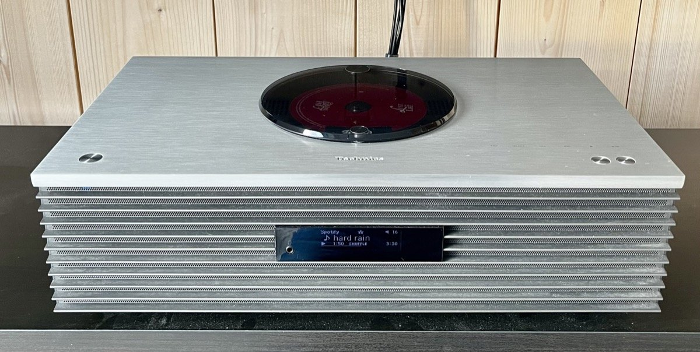

# Technics HiFi widget — volume and Spotify without the app

> **Fully coded by Claude AI** — not a single line of code was written manually by a human.

A small widget for the **Technics SC-C70MK2** (Ottava f): **previous / pause / next / stop**, volume **−/+** and optionally **what is playing** (cover, title, artist). Pause **mutes** the unit (see below why). **One PHP file**, no database, no app, no remote control. Made for a wall tablet or any browser in your home network.

Full version (with cover and title):


Mini version (`$SHOW_TITLE = false`) — only the button row:




## Why

- The volume slider in Spotify on a Mac is awkward, the remote is never at hand and the Technics app is slow.
- The unit has a **local HTTP API without a password**. The official app does not show it and I did not find it described anywhere — it is documented below.

## What works (network API)

| Function | How |
|---|---|
| **Volume** −/+ in steps of 1 (scale 0-100) | `player:volume` |
| **Mute** — the pause button (crossed speaker instead of the volume number) | `settings:/mediaPlayer/mute` |
| **What plays**: cover, title, artist, album, source | `player:player/data` |
| **Previous / next track** | `player:player/control`, `activate` |
| **Stop / play** — real stop, so the unit can go to standby on its own | `player:player/control`, `activate` |
| **Resume Spotify without a phone** — also switches the unit from OPT/CD back to Spotify | `play` with the remembered Spotify session |
| **Start volume** — the unit always wakes up with the same volume (no blast when the TV turns on) | `start-volume.php` from cron, sets the volume while in standby |
| **Power state** (on / standby) | `settings:/system/hostPower` |

## What does not work (and why)

| Function | Why |
|---|---|
| **CD and OPT (TV) input** — switching, play, track info | They are handled by the **main processor** of the unit, not by the network module. The API only reports `stopped`, also in the status stream on port 4545. |
| **Port 10001** (main processor) | TLS with a client certificate (the Technics app) — closed. |
| **CD track names** | The unit has no CD-Text/CDDB over the network. |
| **Power on / off** | Not needed: on LAN (cable) the unit turns itself on when something starts streaming to it and goes to standby on its own. **On Wi-Fi this auto wake-up does not work.** |
| **Real pause in Spotify** | Spotify Connect ends the session on pause (`stopped`, the track disappears). So the middle button **mutes** instead (the music keeps playing quietly, unmute returns to the same volume) and a separate **stop** button really stops it. After stop the widget keeps the last track (greyed out) and "play" resumes the session. |

## Coming soon: ESP32 with infrared

Everything the network API cannot do, the **IR remote** can. An ESP32 with an IR LED (and an IR receiver to record the codes from the original remote, Mode 1) placed near the TV, pointing at the sofa — the reflection reaches the unit.

| Function | Status |
|---|---|
| **Switch to OPT / CD** from the widget | planned |
| **TV turns on → HiFi on + OPT** automatically (TV detected on the network, e.g. Google Cast on port 8009), volume set over the API | planned — the main goal |
| CD play / stop / tracks | planned |

## Install

You need PHP 7.4+ with the `curl` extension, on a machine in the same network as the unit (Raspberry Pi, NAS, any web server).

1. Give the unit a fixed IP in your router.
2. Copy `hifi.php` to your web server and set the IP at the top:

```php
$HIFI_IP = '192.168.1.229';
$SHOW_TITLE = true;   // false = mini version (only the button row); or per page: hifi.php?title=0
```

3. Open `http://your-server/hifi.php`. Or in your own page:

```html
<iframe src="hifi.php" style="width:100%;height:200px;border:0"></iframe>
```

4. Optional — start volume. Set `$HIFI_IP` and `START_VOL` in `start-volume.php` and add to cron:

```
* * * * * php /path/to/start-volume.php > /dev/null
```

"Resume Spotify" needs Spotify to be played once from a phone or computer after the server restarts (the session is kept in the temp directory).

## API of the unit (StreamUnlimited StreamSDK)

No login, plain HTTP on port 80.

```
GET /api/getData?path=player:volume&roles=value
-> [{"type":"i32_","i32_":16}]

GET /api/setData?path=player:volume&role=value&value={"type":"i32_","i32_":20}
-> true

GET /api/getData?path=player:player/data&roles=value
-> state (playing / paused / stopped), trackRoles (title, icon = cover URL),
   mediaData.metaData (artist, album, serviceID: spotify, AUX, airplay, ...), mediaRoles

GET /api/setData?path=player:player/control&role=activate&value={"control":"next"}
-> null   (previous / next / pause / play; null is a success)

GET /api/setData?path=player:player/control&role=activate&value={"control":"play","mediaRoles":{...}}
-> resumes a remembered session (mediaRoles taken from player:player/data)

GET /api/getData?path=settings:/system/hostPower&roles=value
-> [{"type":"bool_","bool_":false}]   (false = standby)
```

Port **4545** is a push stream of state changes (JSON). The volume can be written also in standby — the unit then wakes up with it.

Other Technics and Panasonic units with the same network module (e.g. SA-C600, SC-C50, SU-G30) probably answer the same way — not tested.

## Where it comes from

This is the HiFi card of [TymOS](https://github.com/tymoteuszrogalewski/tymos), my smart home system, where it runs on a wall-mounted iPad kiosk.

## License

MIT — see [LICENSE](LICENSE). Technics is a trademark of Panasonic; this project is not affiliated with them.
